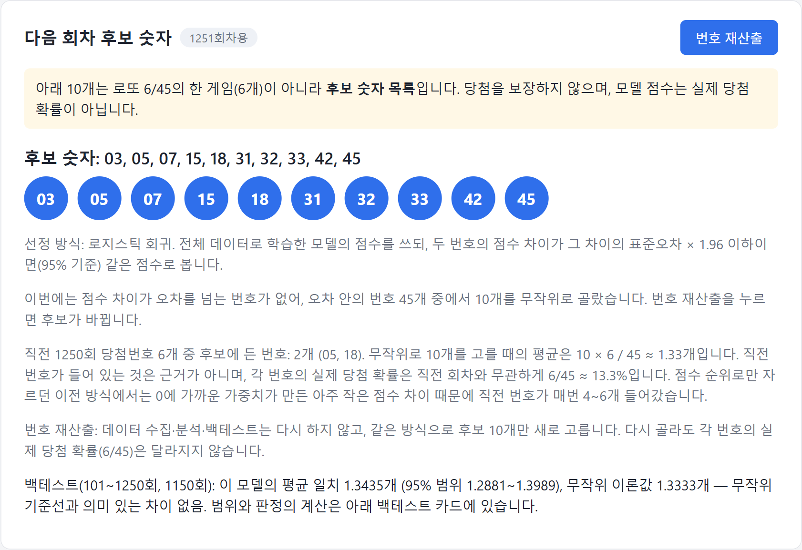
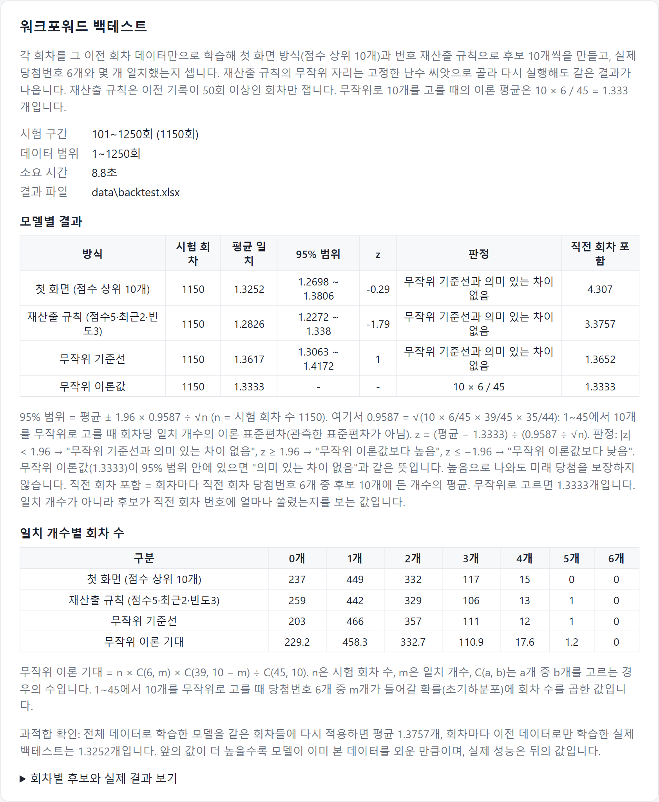
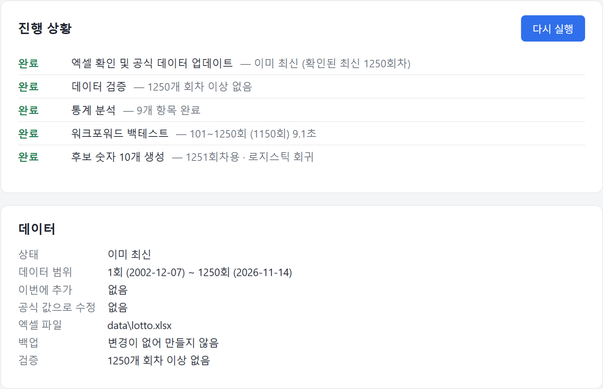
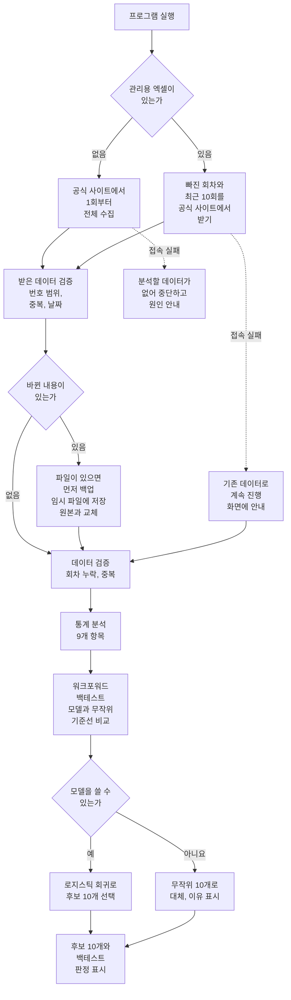

# 통계·후보 번호 생성 프로그램 (로또 6/45)

비개발자인 의뢰인이 PC에서 바로 실행해 쓸 수 있도록 만들어 실행 파일로 납품한 Windows용 로컬 프로그램입니다. 공식 당첨 데이터를 자동으로 모아 검증하고, 통계 분석을 거쳐 다음 회차 후보 숫자 10개를 생성합니다.
당첨 번호를 예측하는 프로그램은 아니며, 통계 모델의 결과를 무작위 선택과 비교한 검증 결과를 후보와 함께 보여 줍니다. 수집, 백업, 분석, 비교는 한 번 실행으로 자동 진행됩니다.

## 주요 화면



여기서 보이는 10개의 숫자는 로또 한 게임(6개)이 아니라, 후보 목록입니다. 바로 아래에서는 무작위로 뽑은 결과와 비교한 판정이 나옵니다.



각 회차마다 직전까지의 데이터만 사용해 후보를 선정하고, 실제 당첨번호와 몇 개가 일치했는지 무작위 선택과 비교합니다.



수집, 검증, 백업이 어떻게 진행됐는지 각 단계별로 보여 줍니다.

## 해결한 문제와 핵심 기능

### 기존 방식의 한계

- 엑셀에 당첨 번호를 일일이 입력해 관리하다 보니, 1\~1244회 정보를 공식 데이터와 대조해봤을 때 4개 회차의 값이 잘못돼 있었습니다(당첨번호 2건, 보너스 번호 2건).
- 분석 결과가 정말 의미 있는지, 아니면 단순한 우연인지 판단하기도 어려웠습니다.

### 자동화된 기능

- **공식 데이터 자동 수집 및 교정**: 실행할 때마다 빠진 회차를 공식 사이트에서 받아 옵니다. 최근 10회는 공식 값과 다시 비교해 다르면 즉시 바로잡고, 변경 이력도 엑셀에 남깁니다. 일일이 입력할 필요가 없어 실수할 걱정이 없습니다.
- **데이터 보호**: 엑셀 파일이 바뀌기 직전에만 백업을 만들고, 최근 10개까지 보관합니다. 새 데이터를 임시 파일에 먼저 저장한 뒤에 원본을 바꿔서, 저장 중 오류가 나더라도 원본 파일은 안전하게 남겨둡니다. 공식 사이트에 없는 회차 정보는 저장하지 않습니다.
- **한 번 실행으로 모두 자동 진행**: 화면을 열면 수집, 데이터 검증, 통계 분석 9가지, 백테스트, 후보 선정까지 순서대로 자동 진행되고, 단계별로 진행 상황도 바로 확인할 수 있습니다. 누락이나 중복된 회차, 범위를 벗어난 번호, 보너스 번호 중복, 잘못된 날짜 같은 문제는 이유를 화면에 보여줍니다.
- **무작위 기준선과의 성적 비교**: 과거 각 회차마다 그 전까지의 데이터만으로 후보를 뽑아, 무작위로 고른 결과와 성적을 비교합니다. 예를 들어, 2026-11-18에 101\~1250회(1,150개 회차)까지 측정한 결과, 후보 10개가 실제 당첨번호 6개와 겹친 평균 개수는 1.3435개였습니다. 무작위 선택으로도 평균 1.3333개가 겹치기 때문에, 의미 있는 차이는 아니었습니다(95% 구간 1.2881\~1.3989개, z값 0.36). 이 결과는 후보 아래에 바로 표시됩니다.
- **모든 수치에 계산식 공개**: 화면에 보이는 가중치, 95% 구간, 판정에는 계산식을 함께 적어뒀습니다. 모델 점수는 당첨 확률을 뜻하지 않으며, 모델과 상관없이 각 번호의 당첨 확률은 6/45임을 밝히고 있습니다. 만약 모델을 쓸 수 없는 상황이면 무작위로 대신 고르고, 그 사실도 표시합니다.

### 기획과 검수

주요 요구 사항과 핵심 규칙 10가지를 정해두고, Claude Code를 활용해 구현했습니다. 이후에는 감사와 재현 테스트를 거쳐 검수까지 마쳤습니다.

- **핵심 규칙**: ‘데이터베이스와 클라우드 사용 금지’, ‘바꾸기 전에는 무조건 백업’, ‘이전 회차 데이터만 사용해 예측’, ‘효과 과장 금지’ 등 미리 정한 규칙부터 지켰고, 모든 기능은 이 원칙에 맞췄습니다.
- **감사 과정**: 2026-10-31에 코드가 규칙 10가지를 모두 지키는지 하나씩 점검했습니다. 처음에는 6개만 통과했고, 나머지 4개는 실제 문제 상황을 만들어 직접 수정한 뒤, 이런 경우가 다시 생기지 않도록 자동 테스트로 남겼습니다. 2026-11-10에는 모든 항목이 통과했습니다.
- **결정 기록**: 중요한 선택은 각각의 대안과 그 근거를 비교해서 결정하고, 결정한 날짜도 함께 남겼습니다. 예를 들어, 점수가 높은 순서대로 10개를 뽑았더니 별다른 기준 없이 직전 회차 번호가 평균 4.31개 정도 섞였습니다(2026-11-09 기준, 무작위로 뽑으면 기대값은 1.33개입니다). 그래서 점수 차이가 오차 범위 안에 있으면 같은 점수로 간주하고, 나머지는 무작위로 채우는 방식으로 바꿨습니다. 이렇게 했더니 같은 측정에서 그 숫자가 1.49개로 줄었습니다.

## 전체 시스템 흐름



공식 데이터는 동행복권 당첨결과 페이지가 내부에서 쓰는 조회 주소로 받습니다. 공개 API가 아니어서 사이트가 개편되면 수집이 멈출 수 있습니다. 이때는 이미 받아 둔 데이터로 분석을 이어 갑니다.

## 기술 스택

| 구분 | 사용 기술 | 비고 |
| --- | --- | --- |
| 프런트엔드 | HTML, CSS, JavaScript | 프레임워크와 빌드 단계 없음 |
| 백엔드 | Python 3.12, FastAPI, uvicorn | 사용자 PC(`127.0.0.1`) 안에서만 동작 |
| 계산 | numpy, pandas | 로지스틱 회귀를 numpy로 직접 구현 |
| DB/인프라 | 데이터베이스 없음, Excel 파일로 저장(openpyxl) | 클라우드 없음. 외부 통신은 공식 당첨결과 조회뿐 |
| 자동화/테스트 | unittest(테스트 98개), 가짜 공식 서버, PyInstaller, PowerShell 빌드 스크립트 | 2026-11-18 기준 모두 통과. 인터넷 없이 실행 |
| 개발 도구 | Claude Code, VS Code, Git | |

## 로컬 실행 및 테스트

Windows, Python 3.12 환경에서 개발하고 테스트했습니다. 프로젝트 폴더에서 아래 명령을 실행합니다.

```powershell
python -m venv .venv
.\.venv\Scripts\Activate.ps1
pip install -r requirements.txt
python main.py
```

브라우저에서 `http://127.0.0.1:8000`을 엽니다. 처음 실행할 때는 공식 데이터 전체를 받느라 3\~6분 정도 걸립니다.

자동 테스트는 아래 명령으로 실행합니다.

```powershell
python -m unittest discover -s tests -t .
```

## 데이터 파일

- `data\lotto.xlsx`: `당첨번호` 시트(1회부터 회차순)와 `변경기록` 시트(생성, 추가, 수정, 삭제 이력). 프로그램이 공식 데이터로 만들고 관리합니다.
- `data\backtest.xlsx`: 회차별 후보, 실제 당첨번호, 요약. 실행할 때마다 새로 만듭니다.
- `data\backup\`: `lotto.xlsx`가 바뀌기 직전의 사본. 최근 10개를 남깁니다.
- Excel에서 파일을 열어 둔 채 실행하면 원본은 건드리지 않고, 파일을 닫은 뒤 다시 실행하라고 안내합니다.

## 배포용 빌드

- `.\build.ps1`을 실행하면 `dist\LottoAnalyzer.zip`과 SHA-256 해시 파일이 만들어집니다.
- 받는 사람은 압축을 풀고 `LottoAnalyzer.exe`를 실행합니다. Python은 필요 없고, 첫 실행에는 인터넷 연결이 필요합니다.
- 새 버전으로 바꿀 때는 `data\` 폴더는 그대로 두고 나머지 파일만 덮어씁니다.

## 작성자

Bluecode77732
