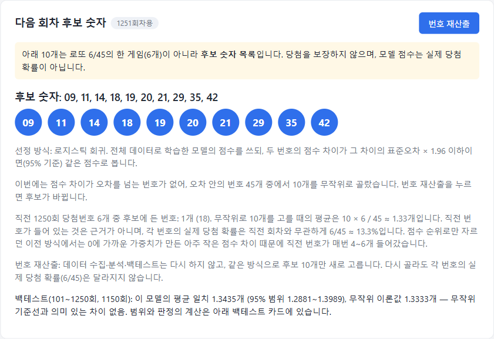

# 로또 6/45 번호 분석 프로그램

공식 당첨 데이터를 자동으로 모아 분석하고, 다음 회차 **후보 숫자 10개**를 보여 주는 Windows용 로컬 웹 앱입니다.
후보 바로 옆에 "이 방식이 무작위로 고르는 것보다 나은가"를 직접 잰 백테스트 결과를 함께 보여 줍니다.

로또는 회차마다 독립인 무작위 추첨입니다. 그래서 이 앱은 당첨을 돕는 도구가 아닙니다.
과거 기록으로 다음 번호를 예측할 수 있는지를 정직하게 측정해 보여 주는 도구입니다.
지금까지 측정한 결과로는 무작위 선택과 의미 있는 차이가 없었습니다(아래 수치).



## 왜 만들었나

번호 추천에서 "분석"이라는 말은 근거가 있다는 인상을 주기 쉽습니다. 이 앱은 그 인상 대신 측정값을 보여 주도록 만들었습니다.

- 화면의 점수, 확률, 범위마다 계산식을 함께 보여 줍니다.
- 모델 점수를 당첨 확률로 표현하지 않습니다. 각 번호의 실제 확률은 모델과 무관하게 6/45입니다.
- 후보를 고르는 방식이 화면 설명과 같습니다. 백테스트와 최종 후보가 같은 코드를 씁니다.

설계의 중심은 모델이 아니라 검증 방식입니다. 결과를 믿을 수 있는지는 검증 방식이 정하기 때문입니다.
모델은 가중치를 그대로 보여 줄 수 있는 로지스틱 회귀 하나만 씁니다.

## 핵심 설계

### 1. 정직한 측정

- **워크포워드 백테스트**: 101회부터 최신 회차까지, 각 회차를 그 이전 회차 데이터로만 학습해 후보 10개를 만듭니다.
  그다음 실제 당첨번호 6개(보너스 제외)와 몇 개 일치했는지 셉니다.
- **무작위 기준선**: 같은 회차에서 1~45 중 10개를 균등하게 고른 결과와 비교합니다.
  무작위의 이론 평균은 회차당 10 × 6/45 = 1.3333개입니다.
- **95% 범위와 판정**: `평균 ± 1.96 × 0.9587 ÷ √n`으로 범위를 냅니다. 0.9587은 무작위 선택의 이론 표준편차이고,
  n은 시험한 회차 수입니다. z = (평균 − 1.3333) ÷ (0.9587 ÷ √n)의 절댓값이 1.96보다 작으면 "의미 있는 차이 없음"으로 판정합니다.
- **후보 선택**: 점수 순위를 10위에서 그대로 자르지 않습니다. 두 번호의 점수 차이가 그 차이의 표준오차 × 1.96 이하이면 같은 점수로 봅니다.
  11위보다 확실히 높은 번호만 넣고, 나머지 자리는 오차 안의 번호 중에서 무작위로 채웁니다.
  순위로만 자르던 예전 방식에서는 0에 가까운 가중치가 만든 작은 차이 때문에 직전 회차 번호가 매번 4~6개 들어갔습니다.

**측정 결과** (2026-11-18 실행, 시험 회차 101~1250회, n = 1,150)

| 구분 | 회차당 평균 일치 | 95% 범위 | z | 판정 |
|---|---|---|---|---|
| 로지스틱 회귀 | 1.3435 | 1.2881 ~ 1.3989 | 0.36 | 무작위 기준선과 의미 있는 차이 없음 |
| 무작위 기준선 (측정) | 1.3617 | 1.3063 ~ 1.4172 | 1.00 | 무작위 기준선과 의미 있는 차이 없음 |
| 무작위 이론값 | 1.3333 | — | — | 10 × 6/45 |

- 평균 일치는 회차마다 후보 10개와 실제 당첨번호 6개가 겹친 개수의 평균입니다.
- 같은 실행에서 절편을 뺀 특징 가중치 7개는 모두 절댓값 0.02 미만이었습니다. 과거 출현 기록이 다음 회차 번호를 설명하지 못한다는 뜻입니다.
- 그래서 1251회용 후보에서는 점수만으로 정해진 번호가 0개였고, 10개 모두 오차 안의 45개 번호에서 무작위로 골랐습니다.
- 과적합 확인용으로 전체 데이터로 학습한 모델을 같은 회차에 다시 적용하면 평균 1.3252개였습니다. 백테스트 값(1.3435)과 비슷합니다.


### 2. 데이터 안전

- **자동 수집**: 실행할 때마다 동행복권 공식 당첨결과 조회에서 빠진 회차를 받습니다.
  최근 10회는 공식 값과 다시 대조해, 다르면 바로잡고 `변경기록` 시트에 남깁니다.
- **만들어 넣지 않음**: 공식 응답에 없는 회차는 넣지 않습니다. 엑셀에 공식 최신보다 큰 회차가 있으면 백업한 뒤 지우고 알립니다.
  공식 사이트가 빈 응답을 주면 "이미 최신"이 아니라 업데이트 실패로 표시합니다.
- **변경 전 백업**: 엑셀 내용이 실제로 바뀔 때만, 바꾸기 직전 파일을 `data\backup\`에 복사합니다. 최근 10개를 남깁니다.
  오래된 백업은 저장에 성공한 뒤에만 정리해, 저장이 계속 실패해도 예전 복원 지점이 지워지지 않습니다.
- **원자적 저장**: 같은 폴더의 임시 파일에 먼저 쓴 뒤 교체합니다. 저장 도중 실패하거나 프로그램이 꺼져도 원본은 깨지지 않습니다.
- **로컬 전용**: 서버는 `127.0.0.1`에서만 열립니다. 데이터베이스와 클라우드는 쓰지 않고, 외부 통신은 공식 조회 하나뿐입니다.

### 3. 테스트와 검증

- **자동 테스트 98개** (`unittest`, 2026-11-18 기준 모두 통과). 인터넷 없이 돌아갑니다.
- **가짜 공식 서버**: `tests/helpers.py`가 공식 사이트처럼 응답하는 가짜 서버를 만듭니다.
  빈 응답, 응답 도중 끊김, HTTP 403, 형식이 깨진 응답, 번호가 범위 밖인 회차를 재현해 수집 판정을 시험합니다.
- **미래 데이터 누출 테스트** (`FeatureLeakTest`): t회차 이후의 당첨번호를 전부 바꿔도, t회차까지의 특징값은 그대로인지 확인합니다.
  특징 계산을 고칠 때마다 이 테스트가 통과해야 합니다.
- **핵심 규칙 감사**: 2026-10-31에 코드를 10개 핵심 규칙에 대조했습니다. 6개 통과, 4개 미통과였습니다.
  문제마다 가짜 서버와 임시 폴더로 실제 재현 시나리오를 만들었고, 고칠 때 그 시나리오를 재현 테스트로 남겼습니다.
  2026-11-10에 10개 모두 통과로 바뀌었습니다.
- **실제 실행 확인**: 테스트와 별도로 실제 서버를 임시 데이터 폴더로 띄워 공식 사이트에서 전체 회차를 받습니다.
  화면은 Edge 창으로 열어 버튼을 직접 눌러 확인합니다.

### 4. AI 협업 개발 방식

코드는 Claude Code(AI 코딩 도구)가 작성했습니다. 사람은 무엇을 만들지 정하고, 선택지 중에서 고르고, 결과를 검수했습니다.
AI에게 맡기면서도 결과를 믿을 수 있게 하려고 다음 장치를 두었습니다.

- **규칙 문서**: 바꿀 수 없는 핵심 규칙 10개를 문서로 정해 두었습니다. 데이터베이스 금지, 백업 후 저장, 워크포워드만 사용,
  효과 주장 금지 같은 규칙입니다. 모듈 경계, 검증 절차, 주석 규약도 함께 적어 매 작업의 기준으로 썼습니다.
- **감사**: 코드를 규칙과 하나씩 대조해 통과·미통과를 판정하고, 미통과는 재현과 함께 기록했습니다.
  미통과 규칙은 "지켜진다"고 쓰지 않고, 고치기 전에 사람에게 물었습니다.
- **결정 기록**: 되돌리기 어려운 선택(후보 선택 방식, 학습 유지 여부, 문서 공개 범위 등)은 선택지와 측정값을 놓고 사람이 정했고,
  결정마다 날짜와 근거를 남겼습니다.
- **보고 규칙**: AI는 변경을 보고하기 전에 테스트와 실제 실행으로 확인하고, 확인하지 못한 것은 그대로 밝힙니다.

이 문서들은 작업용이라 저장소에는 올리지 않았습니다.

## 기술 스택

- **백엔드**: Python 3.12, FastAPI, uvicorn
- **계산**: numpy(로지스틱 회귀를 직접 구현), pandas
- **저장**: openpyxl로 읽고 쓰는 엑셀 파일
- **화면**: 빌드 단계 없는 HTML, CSS, JavaScript
- **테스트**: unittest와 가짜 공식 서버
- **배포**: PyInstaller로 만든 zip. Python이 없는 PC에서 exe를 더블클릭해 실행합니다.

## 역할

- **Bluecode77732**: 요구사항과 핵심 규칙을 정하고, 선택지 중에서 결정하고, 결과를 검수했습니다.
- **Claude Code**: 코드, 테스트, 문서를 작성했습니다.

---

## 사용법

### 실행하면 일어나는 일

화면을 열면 아래 순서로 자동 진행되고, 단계별 상태가 표시됩니다. 엑셀 파일을 따로 준비할 필요가 없습니다.

1. **엑셀 확인과 업데이트**: `data\lotto.xlsx`가 없으면 1회차부터 받아 새로 만듭니다. 첫 실행에는 3~6분 걸립니다.
2. **데이터 검증**: 회차 누락과 중복, 번호 범위, 번호 중복, 보너스, 추첨일을 검사합니다.
3. **통계 분석**: 출현 빈도, 홀짝, 구간, 연속번호, 합계, 간격, 끝자리, 직전 회차 중복, 조합 구조의 9개 항목을 계산합니다.
   항목마다 계산 방법을 함께 보여 줍니다. 출현 빈도는 참고 통계일 뿐, 그것만으로 후보를 고르지 않습니다.
4. **워크포워드 백테스트**: 위 "정직한 측정"의 방식으로 무작위 기준선과 비교합니다.
5. **후보 숫자 10개**: 오름차순으로 보여 줍니다. 로또 한 게임(6개)이 아니라 후보 목록이며, 당첨을 보장하지 않습니다.
   데이터가 30회차보다 적거나 학습이 실패하면 무작위로 대체하고 그 이유를 표시합니다.

"다시 실행"은 1번부터 다시 진행합니다. "번호 재산출"은 수집, 분석, 백테스트를 다시 하지 않고 후보 10개만 같은 방식으로 새로 고릅니다.
다시 골라도 각 번호의 실제 당첨 확률(6/45)은 달라지지 않습니다.

### 개발 환경에서 실행 (Windows)

Python 3.10 이상이 필요합니다(개발은 3.12.10에서 했습니다). 프로젝트 폴더에서 실행합니다.

```powershell
python -m venv .venv
.\.venv\Scripts\Activate.ps1
pip install -r requirements.txt
python main.py
```

브라우저에서 `http://127.0.0.1:8000`으로 접속하고, 끝내려면 터미널에서 `Ctrl + C`를 누릅니다.

- `Activate.ps1`이 막히면 `Set-ExecutionPolicy -Scope CurrentUser RemoteSigned`를 한 번 실행합니다.
- 페이지는 반드시 위 주소로 엽니다. `static\index.html`을 파일로 직접 열면 화면만 보이고 동작하지 않습니다.

자동 테스트는 다음 명령으로 돌립니다.

```powershell
python -m unittest discover -s tests -t .
```

### 엑셀 파일

| 파일 | 시트 | 내용 |
|---|---|---|
| `data\lotto.xlsx` | `당첨번호` | `회차`, `추첨일`, `번호1`~`번호6`, `보너스번호`. 1회차부터 회차순 |
| | `변경기록` | `시각`, `회차`, `구분`, `내용`. 생성, 추가, 공식 값으로 수정, 공식에 없는 회차 삭제 |
| `data\backtest.xlsx` | `예측`, `실제`, `요약` | 회차별 후보와 실제 번호, 모델별 평균 일치와 95% 범위. 실행마다 새로 만듦 |
| `data\backup\` | | 바뀌기 직전의 `lotto.xlsx` 사본, 최근 10개 |

- 프로그램이 공식 데이터로 만들고 관리합니다. 손으로 고쳐도 최근 10회는 공식 값으로 되돌아갑니다.
- Excel에서 파일을 열어 둔 채 실행하면 저장하지 못합니다. 이때 원본은 그대로 두고 화면에 안내합니다.
- 전용 파일을 지우면 다음 실행 때 공식 데이터로 새로 만듭니다.

### 실행 파일로 묶어 전달하기

```powershell
.\build.ps1
```

- 결과물은 `dist\LottoAnalyzer.zip`입니다. zip의 SHA-256 값을 화면과 `dist\LottoAnalyzer.zip.sha256.txt`에 남깁니다.
  받는 사람은 묶음 안의 `사용법.txt`대로 이 값을 대조할 수 있습니다.
- 받는 사람은 압축을 풀고 `LottoAnalyzer.exe`를 더블클릭합니다. Python은 필요 없고, 첫 실행에는 인터넷 연결이 필요합니다.
- exe는 쓰기 권한이 있는 폴더(바탕화면, 문서 등)에 둡니다. `Program Files`에서는 `data\` 폴더를 만들지 못해 시작 전에 멈춥니다.
- 새 버전으로 바꿀 때는 `data\` 폴더를 지우지 말고 나머지 파일만 덮어씁니다.
- 화면은 방문 기록이 남지 않는 창(Edge InPrivate, 없으면 Chrome 시크릿)으로 열립니다.
- 서명하지 않은 프로그램이라 처음 실행할 때 "Windows의 PC 보호" 창이 뜰 수 있습니다. "추가 정보 → 실행"으로 넘어갑니다.

### 파일 구성

```
Lottery/
├── main.py          # FastAPI 앱 (/api/run, /api/status, /api/result, /api/redraw)
├── pipeline.py      # 시작 절차를 순서대로 실행하고 진행 상태를 보관
├── collector.py     # 공식 당첨결과 조회, 응답 검증, 재시도 (외부 통신은 여기뿐)
├── data_sync.py     # 엑셀 확인 → 누락·최근 회차 수집 → 대조 → 백업 → 저장
├── excel_store.py   # 전용 엑셀·백테스트 엑셀 읽기/쓰기, 백업, 원자적 저장
├── excel_loader.py  # 당첨번호 행 검증 규칙, 전용 엑셀을 제목 행 기준으로 읽음
├── analysis/        # 통계 분석 9개 항목 (항목마다 독립 모듈)
├── models.py        # 특징값, 로지스틱 회귀, 무작위 기준선, 후보 선택
├── backtest.py      # 워크포워드 백테스트와 집계
├── candidates.py    # 최종 후보 10개 (실패 시 무작위 대체)
├── launcher.py      # 실행 파일 진입점
├── static/          # 화면 (index.html, style.css, app.js)
├── tests/           # 자동 테스트와 가짜 공식 서버
├── images/          # 이 문서의 스크린샷
└── data/            # 실행 중 생성 (git에서 제외)
```

## 주의사항

이 프로그램은 통계적 흥미를 위한 도구이며 당첨을 보장하지 않습니다. 어떤 분석이나 모델로도 무작위 선택보다 나은 결과를 기대할 근거가 없고,
위 백테스트 결과도 그와 일치합니다.

공식 데이터는 동행복권 당첨결과 페이지가 내부적으로 쓰는 조회 주소에서 받습니다. 공개 문서로 안내된 API가 아니어서
사이트가 바뀌면 수집이 멈출 수 있습니다. 그때는 기존 데이터로 분석하고 화면에 알립니다.
