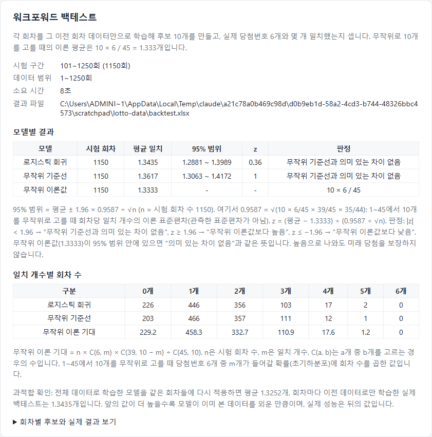

# 통계 기반 번호 조합 분석 프로그램

로또 6/45 공식 당첨 데이터를 자동으로 수집·검증하고, 통계 분석을 거쳐 다음 회차 **후보 숫자 10개**를 생성하는 Windows용 로컬 웹 앱입니다.
생성 결과 옆에는 이 방식을 무작위 선택과 비교해 직접 측정한 백테스트 결과를 함께 표시합니다.

설계의 출발점은 과거 기록으로 다음 결과를 예측할 수 있는지를 수치로 확인하는 것입니다.
추첨은 회차마다 독립이므로, 이 프로그램은 당첨 가능성을 높이는 도구가 아니라 측정 결과를 투명하게 보여 주는 도구로 만들었습니다.
2026-11-18 측정(101~1250회)에서는 무작위 선택과 의미 있는 차이가 없었습니다(아래 수치 참고).


## 개발 배경

번호 추천에서 "분석"이라는 표현은 근거가 있다는 인상을 주기 쉽습니다. 이 프로그램은 그런 인상 대신 측정값을 그대로 보여 주도록 설계했습니다.

* 화면에 나오는 점수, 확률, 범위마다 계산식을 함께 표시합니다.
* 모델 점수를 당첨 확률로 표현하지 않습니다. 각 번호의 실제 당첨 확률은 모델과 관계없이 6/45입니다.
* 화면에 설명한 선택 방식이 실제로 실행되는 코드와 같습니다. 백테스트와 최종 후보 생성은 같은 코드를 씁니다.

설계의 중심은 모델이 아니라 검증 방식입니다. 결과의 신뢰도는 검증 방식이 결정하기 때문입니다.
모델은 가중치를 그대로 공개할 수 있는 로지스틱 회귀 하나만 사용합니다.

---

## 핵심 설계

### 1. 정직한 측정

* **워크포워드 백테스트**: 101회부터 최신 회차까지, 각 회차를 그 이전 회차 데이터로만 학습해 후보 10개를 생성합니다.
  이어서 실제 당첨번호 6개(보너스 제외)와 일치한 개수를 집계합니다.
* **무작위 기준선**: 같은 회차에서 1~45 중 10개를 균등하게 고른 결과와 비교합니다.
  무작위 선택의 이론 평균은 회차당 $10 \times 6/45 = 1.3333$개입니다.
* **95% 범위와 판정**: `평균 ± 1.96 × 0.9587 ÷ √n`으로 범위를 계산합니다. 0.9587은 무작위 선택의 이론 표준편차이고, n은 시험한 회차 수입니다. z = (평균 − 1.3333) ÷ (0.9587 ÷ √n)의 절댓값이 1.96보다 작으면 "의미 있는 차이 없음"으로 판정합니다.
* **후보 선택**: 점수 순위를 10위에서 그대로 자르지 않습니다. 두 번호의 점수 차이가 그 차이의 표준오차 × 1.96 이하이면 같은 점수로 봅니다.
  11위보다 확실히 높은 번호만 먼저 넣고, 남은 자리는 오차 범위 안의 번호 중에서 무작위로 채웁니다.
  순위로만 자르던 이전 방식에서는 0에 가까운 가중치가 만든 작은 차이 때문에 직전 회차 번호가 매번 4~6개 포함되었습니다.

**측정 결과** (2026-11-18 실행, 시험 회차 101~1250회, n = 1,150)

| 구분 | 회차당 평균 일치 개수 | 95% 범위 | z 값 | 판정 결과 |
| --- | --- | --- | --- | --- |
| 로지스틱 회귀 | 1.3435 | 1.2881 ~ 1.3989 | 0.36 | 무작위 기준선과 의미 있는 차이 없음 |
| 무작위 기준선 (실측) | 1.3617 | 1.3063 ~ 1.4172 | 1.00 | 무작위 기준선과 의미 있는 차이 없음 |
| 무작위 이론값 | 1.3333 | — | — | $10 \times 6/45$ |

* 평균 일치 개수는 회차마다 후보 10개와 실제 당첨번호 6개가 겹친 개수의 평균입니다.
* 같은 실행에서 절편을 제외한 특징 가중치 7개는 모두 절댓값 0.02 미만이었습니다. 과거 출현 기록이 다음 회차 번호를 설명하지 못한다는 뜻입니다.
* 이에 따라 1251회차 후보에서는 점수만으로 정해진 번호가 0개였고, 10개 모두 오차 범위 안의 45개 번호에서 무작위로 선택했습니다.
* 과적합 여부를 확인하기 위해 전체 데이터로 학습한 모델을 같은 회차에 다시 적용한 결과, 평균 1.3252개였습니다. 백테스트 값(1.3435)과 비슷한 수준입니다.



### 2. 데이터 안전

* **자동 수집**: 실행할 때마다 동행복권 공식 당첨결과 조회에서 누락된 회차를 확인하고 수집합니다.
  최근 10회는 공식 값과 다시 대조해, 다른 값이 있으면 바로잡고 `변경기록` 시트에 기록합니다.
* **임의 데이터 배제**: 공식 응답에 없는 회차는 저장하지 않습니다. 엑셀에 공식 최신 회차보다 큰 회차가 있으면 백업한 뒤 삭제하고 화면에 알립니다.
  공식 사이트가 빈 응답을 보내면 "이미 최신"으로 처리하지 않고 업데이트 실패로 표시합니다.
* **변경 전 백업**: 엑셀 내용이 실제로 바뀔 때만, 변경 직전 파일을 `data\backup\` 폴더에 복사합니다. 최근 10개를 보관합니다.
  오래된 백업은 저장에 성공한 뒤에만 정리하므로, 저장이 반복해서 실패해도 이전 복원 지점이 유지됩니다.
* **원자적 저장**: 같은 폴더의 임시 파일에 먼저 저장한 뒤 원본과 교체합니다. 저장 중 오류가 나거나 프로그램이 종료되어도 원본 파일은 손상되지 않습니다.
* **로컬 전용**: 서버는 사용자 PC(`127.0.0.1`)에서만 열립니다. 데이터베이스와 클라우드는 사용하지 않으며, 외부 통신은 공식 당첨결과 조회뿐입니다.

### 3. 테스트와 검증

* **자동 테스트 98개** (`unittest`, 2026-11-18 기준 모두 통과). 인터넷 연결 없이 실행됩니다.
* **가짜 공식 서버**: `tests/helpers.py`에 공식 사이트처럼 응답하는 가짜 서버를 구현했습니다.
  빈 응답, 응답 도중 끊김, HTTP 403, 형식이 깨진 응답, 번호가 범위를 벗어난 회차를 재현해 수집 판정을 검증합니다.
* **미래 데이터 누출 테스트** (`FeatureLeakTest`): t회차 이후의 당첨번호를 모두 다른 값으로 바꿔도 t회차까지의 특징값이 그대로인지 확인합니다.
  특징 계산 코드를 수정할 때마다 이 테스트를 통과해야 합니다.
* **핵심 규칙 감사**: 2026-10-31에 코드를 10가지 핵심 규칙과 하나씩 대조했습니다. 첫 감사 결과는 6개 통과, 4개 미통과였습니다.
  문제마다 가짜 서버와 임시 폴더로 재현 시나리오를 만들었고, 수정한 뒤에는 그 시나리오를 재현 테스트로 남겼습니다.
  2026-11-10에 10개 규칙을 모두 통과했습니다.
* **실제 실행 확인**: 테스트와 별도로 임시 데이터 폴더에서 실제 서버를 실행해 공식 사이트의 전체 회차를 수집합니다.
  화면은 Edge 브라우저 창에서 직접 버튼을 눌러 확인합니다.

### 4. AI 협업 개발 방식

코드는 Claude Code(AI 코딩 도구)가 작성했습니다. 개발자는 요구사항을 정하고, 선택지 중에서 결정하고, 결과물을 검수했습니다.
AI에게 구현을 맡기면서도 결과를 신뢰할 수 있도록 다음 장치를 두었습니다.

* **규칙 문서**: 변경할 수 없는 핵심 규칙 10가지를 문서로 정했습니다. 데이터베이스 사용 금지, 백업 후 저장, 워크포워드 방식만 사용, 효과 과장 금지 같은 규칙입니다. 모듈 분리 기준, 검증 절차, 주석 작성 규칙도 함께 정해 모든 작업의 기준으로 삼았습니다.
* **감사**: 코드를 규칙과 하나씩 대조해 통과 여부를 판정하고, 통과하지 못한 항목은 재현 기록과 함께 남겼습니다.
  미통과 규칙은 "지켜진다"고 표기하지 않았고, 수정에 들어가기 전에 개발자의 검토를 거쳤습니다.
* **결정 기록**: 후보 선택 방식, 학습 유지 여부, 문서 공개 범위처럼 되돌리기 어려운 선택은 대안과 측정값을 비교해 결정했고, 결정마다 날짜와 근거를 기록했습니다.
* **보고 규칙**: AI는 변경 사항을 보고하기 전에 테스트와 실제 실행으로 확인하고, 확인하지 못한 부분은 그대로 밝혔습니다.

이 문서들은 개발용이라 저장소에는 올리지 않았습니다.

---

## 기술 스택

* **백엔드**: Python 3.12, FastAPI, uvicorn
* **계산**: numpy(로지스틱 회귀 직접 구현), pandas
* **저장**: openpyxl 기반 엑셀 파일 입출력
* **화면**: 빌드 단계가 없는 HTML, CSS, JavaScript
* **테스트**: unittest, 가짜 공식 서버
* **배포**: PyInstaller로 만든 zip. Python이 설치되지 않은 PC에서도 `.exe` 파일을 실행해 바로 사용할 수 있습니다.

---

## 역할 분담

* **Bluecode77732**: 요구사항과 핵심 규칙을 정하고, 주요 선택지 중에서 결정하고, 최종 결과물을 검수했습니다.
* **Claude Code**: 코드, 테스트, 관련 문서를 작성했습니다.

---

## 사용법

### 실행 절차

화면을 열면 아래 순서로 자동 진행되며, 단계별 진행 상태가 표시됩니다. 엑셀 파일을 미리 준비할 필요가 없습니다.

1. **엑셀 확인 및 업데이트**: `data\lotto.xlsx` 파일이 없으면 1회차부터 최신 회차까지 수집해 새로 만듭니다. 첫 실행에는 3~6분 걸립니다.
2. **데이터 검증**: 회차 누락과 중복, 번호 범위, 보너스 번호, 추첨일 오류를 검사합니다.
3. **통계 분석**: 출현 빈도, 홀짝 비율, 구간, 연속번호, 합계, 간격, 끝자리, 직전 회차 중복, 조합 구조의 9개 항목을 계산합니다.
   항목마다 계산 방법을 함께 표시합니다. 출현 빈도는 참고 통계이며, 이 수치만으로 후보를 고르지 않습니다.
4. **워크포워드 백테스트**: 위 "정직한 측정"의 방식으로 무작위 기준선과 비교합니다.
5. **후보 숫자 10개**: 오름차순으로 표시합니다. 로또 한 게임(6개)이 아니라 후보 목록이며, 당첨을 보장하지 않습니다.
   데이터가 30회차보다 적거나 학습에 실패하면 무작위 번호로 대체하고 그 이유를 화면에 표시합니다.

"다시 실행" 버튼은 1단계부터 전체 과정을 다시 실행합니다. "번호 재산출" 버튼은 수집, 분석, 백테스트를 다시 하지 않고 후보 10개만 같은 방식으로 새로 고릅니다.
다시 골라도 각 번호의 실제 당첨 확률(6/45)은 달라지지 않습니다.

### 개발 환경에서 실행 (Windows)

Python 3.10 이상이 필요합니다(개발 환경은 3.12.10). 프로젝트 폴더에서 터미널을 열고 아래 명령을 실행합니다.

```powershell
python -m venv .venv
.\.venv\Scripts\Activate.ps1
pip install -r requirements.txt
python main.py
```

브라우저에서 `http://127.0.0.1:8000`으로 접속합니다. 종료하려면 터미널에서 `Ctrl + C`를 누릅니다.

* `Activate.ps1` 실행이 막히면 `Set-ExecutionPolicy -Scope CurrentUser RemoteSigned`를 한 번 실행한 뒤 다시 시도합니다.
* 페이지는 반드시 위 주소로 엽니다. `static\index.html` 파일을 직접 열면 화면만 보이고 동작하지 않습니다.

자동 테스트는 아래 명령으로 실행합니다.

```powershell
python -m unittest discover -s tests -t .
```

### 엑셀 파일 구조

| 파일 | 시트 | 내용 |
| --- | --- | --- |
| `data\lotto.xlsx` | `당첨번호` | `회차`, `추첨일`, `번호1`~`번호6`, `보너스번호`. 1회차부터 회차순 |
|  | `변경기록` | `시각`, `회차`, `구분`, `내용`. 생성, 추가, 공식 값으로 수정, 공식에 없는 회차 삭제 이력 |
| `data\backtest.xlsx` | `예측`, `실제`, `요약` | 회차별 후보와 실제 당첨번호, 모델별 평균 일치 개수와 95% 범위. 실행할 때마다 새로 생성 |
| `data\backup\` |  | 변경 직전의 `lotto.xlsx` 사본, 최근 10개 보관 |

* 프로그램이 공식 데이터로 파일을 만들고 관리합니다. 내용을 직접 수정해도 최근 10회는 다음 실행 때 공식 값으로 바로잡힙니다.
* Excel에서 파일을 열어 둔 채 실행하면 저장할 수 없습니다. 이때 원본은 그대로 두고 화면에 안내합니다.
* 전용 엑셀 파일을 삭제하면 다음 실행 때 공식 데이터로 새로 만듭니다.

### 실행 파일(.exe)로 배포

```powershell
.\build.ps1
```

* 빌드 결과물은 `dist\LottoAnalyzer.zip`입니다. zip의 SHA-256 해시 값은 화면과 `dist\LottoAnalyzer.zip.sha256.txt`에 남습니다.
  받는 사람은 압축 파일 안의 `사용법.txt` 안내에 따라 이 값을 대조할 수 있습니다.
* 받는 사람은 압축을 풀고 `LottoAnalyzer.exe`를 실행합니다. Python 설치는 필요 없고, 첫 실행에는 데이터 수집을 위해 인터넷 연결이 필요합니다.
* 실행 파일은 쓰기 권한이 있는 폴더(바탕화면, 문서 등)에 두어야 합니다. `Program Files` 같은 시스템 폴더에서는 `data\` 폴더를 만들 수 없어 시작 단계에서 멈춥니다.
* 새 버전으로 교체할 때는 `data\` 폴더를 유지하고 나머지 파일만 덮어씁니다.
* 화면은 방문 기록이 남지 않는 창(Edge InPrivate, 없으면 Chrome 시크릿 모드)으로 열립니다.
* 코드 서명이 없는 프로그램이라 첫 실행 때 "Windows의 PC 보호" 창이 나타날 수 있습니다. "추가 정보 → 실행"을 누르면 실행됩니다.

### 파일 구조 요약

```
Lottery/
├── main.py          # FastAPI 앱 (/api/run, /api/status, /api/result, /api/redraw)
├── pipeline.py      # 시작 절차를 순서대로 진행하고 상태를 보관
├── collector.py     # 공식 당첨결과 조회, 응답 검증, 재시도 (외부 통신은 여기뿐)
├── data_sync.py     # 엑셀 확인 → 누락 및 최근 회차 수집 → 대조 → 백업 → 저장
├── excel_store.py   # 전용 엑셀·백테스트 엑셀 읽기/쓰기, 백업, 원자적 저장
├── excel_loader.py  # 당첨번호 행 검증 규칙, 전용 엑셀을 제목 행 기준으로 읽음
├── analysis/        # 통계 분석 9개 항목 (항목마다 독립된 모듈)
├── models.py        # 특징값 계산, 로지스틱 회귀, 무작위 기준선, 후보 선택
├── backtest.py      # 워크포워드 백테스트와 결과 집계
├── candidates.py    # 최종 후보 10개 선정 (실패 시 무작위 대체)
├── launcher.py      # 실행 파일 진입점
├── static/          # 화면 파일 (index.html, style.css, app.js)
├── tests/           # 자동 테스트 코드와 가짜 공식 서버
├── images/          # 이 문서에 쓰인 스크린샷
└── data/            # 실행 중 생성되는 폴더 (git에서 제외)
```

---

## 유의 사항

이 프로그램은 통계 분석과 검증 방식을 보여 주기 위한 도구이며, 당첨을 보장하지 않습니다. 추첨이 회차마다 독립이므로 어떤 분석이나 모델로도 무작위 선택보다 나은 결과를 기대할 근거가 없고, 위 백테스트 결과도 이와 일치합니다.

공식 데이터는 동행복권 당첨결과 페이지가 내부적으로 쓰는 조회 주소에서 가져옵니다. 공개 문서로 안내된 API가 아니어서 사이트가 개편되면 수집이 멈출 수 있습니다. 이 경우 기존 데이터로 분석을 계속하고 화면에 안내합니다.
